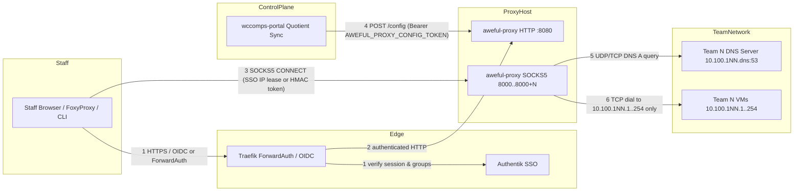

# Threat model

What `aweful-proxy` defends, against whom, and the rules a change must keep. Every mitigation cites the Go file and
function or type that enforces it; a change that moves a trust boundary updates this file in the same pull request.

## Attackers and their goals

| Attacker | Starts with | Wants |
|---|---|---|
| Blue team competitor | A shared team Authentik account (`WCComps_BlueTeam`), a team VM in `10.100.1XX.0/24` | To reach another team's subnet (`10.100.1YY.0/24`) through the proxy, or to read or overwrite proxy configuration |
| Unauthenticated network peer | Reachability to the proxy host on `:8080` or `8000..8000+N` without a staff Authentik login | To pivot into Blue Team networks or internal infrastructure (`10.0.0.0/16`, `10.2.0.0/24`, `172.16.0.0/12`), or to push a malicious `POST /config` |
| Hostile Blue Team DNS server | Control of `10.100.1XX.<dns_octet>:53` for their own team | To return a DNS `A` record pointing to `127.0.0.1`, management infrastructure (`10.0.0.x`), or another team (`10.100.1YY.x`) so a grading staff browser hits the wrong target |
| Rogue browser tab | A staff member's browser visiting an untrusted page while signed in | Cross-site request forgery against `POST /config` or script injection through rendered configuration fields |

## Assets ranked by impact

1. **Proxy host and internal management/container networks**: the proxy host's own loopback (`127.0.0.0/8`), management
   interfaces (`10.0.0.0/16`, `10.2.0.0/24`), and local container bridges (`172.16.0.0/12`) must never be reachable as
   SOCKS5 destinations (`resolver.go` `Resolver.TranslateAndValidateIPv4`; `auth.go` `overlapsLocalInterfaceSubnet`).
2. **Cross-team network isolation**: a connection on port `base_socks_port + N` (`8000 + N`) must only ever dial a
   destination inside Team `N`'s external `/24` (`10.100.1NN.1..254`), never another team's subnet (`resolver.go`
   `Resolver.Resolve`, `Resolver.TranslateAndValidateIPv4`; `socks5.go` `Socks5Server.handleConnection`).
3. **Staff-only access (Authentik SSO)**: only authenticated staff holding an allowed Authentik group (`auth.go`
   `defaultStaffGroups`, `hasAllowedGroup`, `Authenticator.AuthenticateRequest`, `CheckSocksAuth`) may view the status
   page, download `foxyproxy-teams.json`, or establish SOCKS5 connections when SSO is enabled.
4. **Configuration integrity (`POST /config`)**: only `wccomps-portal` presenting the shared `AWEFUL_PROXY_CONFIG_TOKEN`
   bearer secret (`http_server.go` `NewHTTPHandler`) may update the active competition network configuration.
5. **Availability during an event**: a single client IP or a listener reconfiguration must not starve or drop active
   staff grading sessions (`socks5.go` `maxConcurrentConns`, `maxConnsPerClient`, `Socks5Server.Reconcile`).

## Trust boundaries and data flows

## Threats per boundary (STRIDE) and their mitigations

| # | Boundary | Threat | Mitigation |
|---|---|---|---|
| 1, 2 | Browser to HTTP (`:8080`) | S, E: an unauthenticated user or a Blue Team competitor (`WCComps_BlueTeam`) accesses `/` or `/foxyproxy.json` | When SSO is enabled (`RequireSSO`, `OIDCClientID`, or `TrustForwardAuth`), `Authenticator.AuthenticateRequest` verifies either the HMAC-signed `aweful_session` OIDC cookie or `X-authentik-*` headers from `TrustedProxyCIDRs`, and `hasAllowedGroup` requires a staff group in `AllowedGroups` (`auth.go` `Authenticator.AuthenticateRequest`, `Authenticator.HandleCallback`, `hasAllowedGroup`; `http_server.go` `NewHTTPHandler`) |
| 1, 2 | Browser to HTTP (`:8080`) | S: OAuth login CSRF or open redirect | `Authenticator.HandleLogin` binds an `HttpOnly`, `SameSite=Lax` nonce cookie (`aweful_oauth_state`) and PKCE `S256` verifier to an HMAC-signed `state` with a 300 s lifetime, verified in constant time in `Authenticator.HandleCallback`, and restricts `next` to a relative path starting with single `/` (`auth.go` `Authenticator.HandleLogin`, `Authenticator.HandleCallback`) |
| 2 | Browser to HTTP (`:8080`) | T, E: script injection through status page or FoxyProxy export | `GET /` renders through `html/template` (`http_server.go` `statusPageTmpl`), and `TeamDomainName` and `ProxyAdvertiseHost` are validated by `isValidHostOrIP` (`config.go` `Config.Validate`; `http_server.go` `isValidHostOrIP`) |
| 2, 3 | Blue Team VM to HTTP or SOCKS5 | E: a Blue Team VM in `10.100.1XX.0/24` connects to the proxy to pivot into another team | `IsClientAllowed` rejects any request or connection whose client IP falls within `TeamExternalPrefix(1..NumberOfTeams)` or outside `AllowedClientCIDRs` (`auth.go` `IsClientAllowed`; `http_server.go` `NewHTTPHandler`; `socks5.go` `Socks5Server.handleConnection`) |
| 3 | Client to SOCKS5 (`8000..8000+N`) | S, E: an unauthenticated host connects to a SOCKS5 port | When SSO is enabled, `Socks5Server.negotiateAuth` and `Socks5Server.readUserPassAuth` call `CheckSocksAuth`, which requires either an active Authentik SSO IP lease (`Authenticator.LookupIPLease`) or a valid HMAC-signed staff token (`Authenticator.VerifySocksToken`) (`auth.go` `CheckSocksAuth`; `socks5.go` `Socks5Server.negotiateAuth`, `Socks5Server.readUserPassAuth`) |
| 3 | Client to SOCKS5 (`8000..8000+N`) | T, E: a client on Team `N`'s port requests a host or IP belonging to another team or non-team domain | Each listener `base_socks_port + N` passes a fixed `team = N` to `handleConnection`; `readUserPassAuth` rejects mismatched team usernames, `Resolver.Resolve` rejects IPv6 and domains outside `TeamDomainName`, and `Resolver.TranslateAndValidateIPv4` rejects any resulting IP outside `TeamExternalPrefix(team)` (`socks5.go` `Socks5Server.handleConnection`, `parseTeamAndUser`; `resolver.go` `Resolver.Resolve`, `Resolver.TranslateAndValidateIPv4`) |
| 3 | Client to SOCKS5 (`8000..8000+N`) | D: a single client opens thousands of idle connections and exhausts the proxy | `Socks5Server` caps total concurrent connections at `maxConcurrentConns` (`1024`), caps concurrent connections per client IP at `maxConnsPerClient` (`128`), and enforces handshake and idle deadlines (`socks5.go` `Socks5Server.acquireClientConn`, `Socks5Server.handleConnection`, `pipeConnections`) |
| 4 | Portal to `POST /config` | S, T, E: an unauthorized client or cross-origin browser tab overwrites proxy configuration | `POST /config` fails closed with `503` when `ConfigToken` is empty, compares `Authorization: Bearer <token>` in constant time, rejects requests with an `Origin` header or cross-site `Sec-Fetch-Site` or non-`application/json` `Content-Type`, and decodes only `ConfigUpdate` with `DisallowUnknownFields` (`http_server.go` `NewHTTPHandler`; `config.go` `ConfigUpdate`) |
| 4 | Portal to `POST /config` | T: a config update sets `external_mask` to loopback or a proxy-host interface subnet | `Config.Validate`, `overlapsLocalInterfaceSubnet`, and `POST /config` reject loopback, link-local, multicast, unspecified, and local host interface subnets, and `Socks5Server.Reconcile` binds all new ports before closing superseded listeners (`config.go` `Config.Validate`, `isValidThreeOctetPrefix`; `auth.go` `overlapsLocalInterfaceSubnet`; `socks5.go` `Socks5Server.Reconcile`) |
| 5, 6 | Proxy to Team DNS & Team VMs | T, E: a hostile Blue Team DNS server returns `127.0.0.1`, `10.0.0.x`, or another team's IP | `Resolver.Resolve` passes every DNS `A` record through `Resolver.TranslateAndValidateIPv4`, which translates `InternalMask` to `TeamExternalPrefix(team)` and rejects any IP not in that team's `/24` (`1..254`) or overlapping a local host interface (`resolver.go` `Resolver.Resolve`, `Resolver.TranslateAndValidateIPv4`) |
