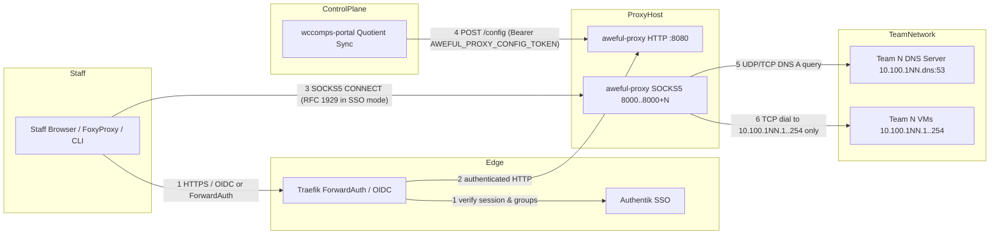

# Threat model

What `aweful-proxy` defends, against whom, and the rules a change must keep. Every mitigation cites the Go file, line,
and function or type that enforces it; a change that moves a trust boundary updates this file in the same pull request.

## Attackers and their goals

| Attacker | Starts with | Wants |
|---|---|---|
| Blue team competitor | A shared team Authentik account (`WCComps_BlueTeam`), a team VM in `10.100.1XX.0/24` | To reach another team's subnet (`10.100.1YY.0/24`) through the proxy, or to read or overwrite proxy configuration |
| Unauthenticated network peer | Reachability to the proxy host on `:8080` or `8000..8000+N` without a staff Authentik login | To pivot into Blue Team networks or internal infrastructure (`10.0.0.0/16`, `10.2.0.0/24`, `172.16.0.0/12`), or to push a malicious `POST /config` |
| Hostile Blue Team DNS server | Control of `10.100.1XX.<dns_octet>:53` for their own team | To return a DNS `A` record pointing to `127.0.0.1`, management infrastructure (`10.0.0.x`), or another team (`10.100.1YY.x`) so a grading staff browser hits the wrong target |
| Rogue browser tab | A staff member's browser visiting an untrusted page while signed in | Cross-site requests to change proxy configuration or issue or revoke a SOCKS credential |

## Assets ranked by impact

1. **Proxy host and internal management/container networks**: the proxy host's own loopback (`127.0.0.0/8`), management
   interfaces (`10.0.0.0/16`, `10.2.0.0/24`), and local container bridges (`172.16.0.0/12`) must never be reachable as
   SOCKS5 destinations (`resolver.go:139` `Resolver.TranslateAndValidateIPv4`; `auth.go:642` `overlapsLocalInterfaceSubnet`;
   `http_server.go:481` `hasLoopbackPrefix`).
2. **Cross-team network isolation**: a connection on port `base_socks_port + N` (`8000 + N`) must only ever dial a
   destination inside Team `N`'s external `/24` (`10.100.1NN.1..254`), never another team's subnet (`resolver.go:90`
   `Resolver.Resolve`, `resolver.go:139` `Resolver.TranslateAndValidateIPv4`; `socks5.go:244` `Socks5Server.handleConnection`).
3. **Staff-only access (Authentik SSO) and signing secrets**:
   - **Service credentials**: `AWEFUL_PROXY_CONFIG_TOKEN` (`config.go:54` `Config.ConfigToken`, `json:"-"`) authenticates
     `POST /config` from `wccomps-portal`; `AWEFUL_PROXY_OIDC_CLIENT_SECRET` (`config.go:58` `Config.OIDCClientSecret`, `json:"-"`)
     authenticates OAuth code exchange with Authentik; `AWEFUL_PROXY_SESSION_SECRET` (`config.go:59` `Config.SessionSecret`, `json:"-"`)
     derives the 32-byte SHA-256 HMAC key (`auth.go:80` `NewAuthenticator`).
   - **Credential separation**: `signJSON` (`auth.go:206`) seals browser cookies; `startBrowserSession` (`auth.go:109`)
     registers their session IDs. `issueSocksCredential` (`auth.go:156`) generates a separate random 256-bit password
     and stores its hash, expiry and issuing session ID under the stable subject's SOCKS username.
   - **Delegated user credentials**: issuance requires an allowed identity, an active local session, and a subject
     not blocked in startup configuration (`auth.go:236`, `auth.go:156`). Logout removes the local session and any grant
     it issued under the same lock as issuance (`auth.go:461`). Each new SOCKS handshake checks expiry and the password
     hash (`auth.go:197`).
4. **Configuration integrity (`POST /config`)**: only `wccomps-portal` presenting the shared `AWEFUL_PROXY_CONFIG_TOKEN`
   bearer secret (`http_server.go:351` `NewHTTPHandler`) may update the active competition network configuration.
5. **Availability during an event**: a single client IP or a listener reconfiguration must not starve or drop active
   staff grading sessions (`socks5.go:40` `maxConcurrentConns`, `socks5.go:41` `maxConnsPerClient`, `socks5.go:96`
   `Socks5Server.Reconcile`).

## Entry points

| Surface | Entry point | Authentication & authorization gate | Handler |
|---|---|---|---|
| HTTP `:8080` | `GET /` | `IsClientAllowed` (`auth.go:587`) + `requireStaffAuth` | `http_server.go:265` |
| HTTP `:8080` | `GET /foxyproxy.json` | `IsClientAllowed` + `requireStaffAuth`; never includes credentials | `http_server.go:451` |
| HTTP `:8080` | `GET /config` | `IsClientAllowed` + `requireStaffAuth` | `http_server.go:342` |
| HTTP `:8080` | `POST /config` | `IsClientAllowed` + fail-closed config token + cross-origin checks | `http_server.go:351` |
| HTTP `:8080` | `GET /healthz` | `IsClientAllowed`; read-only status summary | `http_server.go:327` |
| HTTP `:8080` | `GET /auth/login` | `IsClientAllowed`; initiates OIDC PKCE `S256` flow | `http_server.go:199`, `auth.go:273` |
| HTTP `:8080` | `GET /auth/callback` | `IsClientAllowed` + signed state + nonce cookie + `hasAllowedGroup` | `http_server.go:202`, `auth.go:328` |
| HTTP `:8080` | `POST /auth/socks/session` | Client ACL + same-origin POST + allowed ForwardAuth identity | `http_server.go:227` |
| HTTP `:8080` | `POST /auth/socks`, `POST /auth/socks/revoke` | Client ACL + same-origin POST + allowed identity + live local session; issuance also checks the operator blocklist | `http_server.go:240`, `http_server.go:257` |
| HTTP `:8080` | `POST /auth/logout` | Client ACL + same-origin POST; invalidates the verified local session and any grant it issued | `http_server.go:205`, `auth.go:461` |
| SOCKS5 `8000..8000+N` | TCP `CONNECT` | `IsClientAllowed` + RFC 1929 verification in SSO mode + `Resolver.Resolve` | `socks5.go:244`, `socks5.go:336`, `auth.go:197` |

## Trust boundaries and data flows

## Threats per boundary (STRIDE) and their mitigations

| # | Boundary | Threat | Mitigation |
|---|---|---|---|
| 1, 2 | Browser to HTTP (`:8080`) | S, E: an unauthenticated user or a Blue Team competitor accesses a staff endpoint | `AuthenticateRequest` (`auth.go:236`) checks the active OIDC session or trusted Authentik headers including a stable user ID, then requires an allowed group. A ForwardAuth session cookie alone is not accepted. |
| 1, 2 | Browser to HTTP (`:8080`) | S: forged forwarded IP bypasses a network ACL | `ClientIPFromRequest` (`auth.go:560`) only honors `X-Forwarded-For` from a trusted peer. The IP does not authorize SOCKS. |
| 1, 2 | Browser to HTTP (`:8080`) | S: OAuth login CSRF or open redirect | `HandleLogin` (`auth.go:273`) signs short-lived state and binds the flow to a nonce cookie and PKCE; `HandleCallback` (`auth.go:328`) verifies them and redirects to a relative path. |
| 2 | Browser to HTTP (`:8080`) | T, D: an untrusted page issues or revokes a credential, or a logged-out browser replays its cookie | `sameOriginPost` (`auth.go:487`) checks `Origin` and `Sec-Fetch-Site`. The issuance response is `no-store`; shared presets contain no credentials. Issuance checks session liveness under the same lock used to invalidate it on logout (`auth.go:156`, `auth.go:461`). |
| 2 | Browser to HTTP (`:8080`) | T, E: script injection or proxy host hijacking through status page or FoxyProxy export | `GET /` uses `html/template`; `resolveAdvertiseHost` only uses `ProxyAdvertiseHost` or a validated `Host` header (`http_server.go`). |
| 2, 3 | Blue Team VM to HTTP or SOCKS5 | E: a Blue Team VM connects to the proxy to pivot into another team | `IsClientAllowed` (`auth.go:587`) rejects traffic from team external subnets and enforces the optional client ACL. |
| 3 | Client to SOCKS5 (`8000..8000+N`) | S, E: an unauthenticated peer connects to SOCKS, including from the same NAT as staff | SSO mode only negotiates RFC 1929 (`socks5.go:336`) and requires a valid credential (`socks5.go:398`, `auth.go:197`). IP addresses only participate in ACLs and rate limits. |
| 3 | Client to SOCKS5 (`8000..8000+N`) | T, E: a client on Team `N`'s port requests a host or IP belonging to another team or non-team domain | Each listener `base_socks_port + N` passes a fixed `team = N` to `handleConnection` (`socks5.go:138`, `socks5.go:244`); `parseTeamAndUser` (`socks5.go:411`) rejects mismatched team usernames, `Resolver.Resolve` (`resolver.go:90`) rejects IPv6 and domains outside `TeamDomainName`, and `Resolver.TranslateAndValidateIPv4` (`resolver.go:139`) rejects any resulting IP outside `TeamExternalPrefix(team)` |
| 3 | Client to SOCKS5 (`8000..8000+N`) | D: a single client opens thousands of idle connections and exhausts the proxy | `Socks5Server` caps total concurrent connections at `maxConcurrentConns` (`1024`, `socks5.go:40`), caps concurrent connections per client IP at `maxConnsPerClient` (`128`, `socks5.go:41`, `socks5.go:180` `Socks5Server.acquireClientConn`), checks `s.closed` before tracking connections (`socks5.go:166`, `socks5.go:180`), and enforces handshake and idle deadlines (`socks5.go:252`, `socks5.go:514` `pipeConnections`) |
| 4 | Portal to `POST /config` | S, T, E: an unauthorized client or cross-origin browser tab overwrites proxy configuration | `POST /config` fails closed with `503` when `ConfigToken` is empty (`http_server.go:292`), compares `Authorization: Bearer <token>` in constant time (`http_server.go:302`), rejects requests with an `Origin` header or cross-site `Sec-Fetch-Site` (`http_server.go:313`) or non-`application/json` `Content-Type` (`http_server.go:321`), and decodes only `ConfigUpdate` with `DisallowUnknownFields` (`config.go:67`, `http_server.go:332`) |
| 4 | Portal to `POST /config` | T: a config update sets `external_mask` to loopback or a proxy-host interface subnet | `Config.Validate` (`config.go:258`), `isValidThreeOctetPrefix` (`config.go:313`), `overlapsLocalInterfaceSubnet` (`auth.go:595`), and `hasLoopbackPrefix` (`http_server.go:414`) reject loopback, link-local, multicast, unspecified, and local host interface subnets across all teams `0..NumberOfTeams`, and `Socks5Server.Reconcile` (`socks5.go:96`) binds all new ports before closing superseded listeners |
| 5, 6 | Proxy to Team DNS & Team VMs | T, E: a hostile Blue Team DNS server returns `127.0.0.1`, `10.0.0.x`, or another team's IP | `Resolver.Resolve` (`resolver.go:90`) passes every DNS `A` record through `Resolver.TranslateAndValidateIPv4` (`resolver.go:139`), which translates `InternalMask` to `TeamExternalPrefix(team)` and rejects any IP not in that team's `/24` (`1..254`) or overlapping a local host interface (`auth.go:595` `overlapsLocalInterfaceSubnet`) |

## Accepted risks and non-goals

- **SOCKS credential transport and lifetime.** RFC 1929 sends the password in cleartext. Keep SOCKS on a trusted private
  network; HTTP TLS alone does not protect the SOCKS handshake. Firefox supports SOCKS passwords; Chrome does not.
  Grants and browser sessions live in one process; a restart invalidates both. Expiry and revocation block new
  connections, not open tunnels (`auth.go:197`, `socks5.go:333`). Non-SSO listeners belong on the isolated machine network.
- **Local logout and upstream deprovisioning are separate.** ForwardAuth still has an upstream session after local
  logout; starting another local session is explicit and requires currently allowed headers. OIDC groups are a
  sign-in snapshot. Persist `AWEFUL_PROXY_BLOCKED_SOCKS_SUBJECTS` in startup configuration and restart to invalidate
  local sessions and block new issuance. HTTP configuration updates cannot change the blocklist (`config.go:67`, `config.go:195`).
- **Layer-4 transparent forwarding.** `aweful-proxy` is a Layer-4 TCP proxy (`socks5.go:514` `pipeConnections`). It does
  not terminate TLS or isolate browser cookies between teams; staff must use separate browser containers or private
  windows when switching teams (`http_server.go:123`).
- **Blue Team DNS availability.** Each team's DNS server (`10.100.1XX.<dns_octet>:53`) is authoritative for that team's
  domain; if a team's DNS server is down, hostname resolution for that team fails fast after `DNSTimeoutMs` (`2000 ms`,
  `resolver.go:52` `Resolver.queryDNS`) while literal IPv4 access (`192.168.220.Y` or `10.100.1XX.Y`) continues to work.

## Build and deploy path

1. Changes land on `main` through a pull request verified by `.github/workflows/ci.yml` (`.github/workflows/ci.yml:1-64`),
   which runs `go vet ./...` and `go test -race ./...` (`aweful_proxy_test.go`) on pull requests and pushes to `main`,
   and publishes `ghcr.io/wccomps/aweful-proxy` (`sha-<short>` and `main`) to GHCR on pushes to `main` using
   `GITHUB_TOKEN` (`packages: write`, `.github/workflows/ci.yml:30-32`).
2. `Dockerfile` (`Dockerfile:1-14`) builds a static Go binary (`CGO_ENABLED=0`) and packages it on
   `gcr.io/distroless/static-debian12:nonroot` running as an unprivileged user on ports `8080` and `8000-8050`, seeding
   initial defaults from `/etc/aweful-proxy/config.json` via `AWEFUL_PROXY_SEED_CONFIG` (`Dockerfile:10-11`,
   `config.go:111-115` `LoadConfig`) while writing runtime `POST /config` updates to `/tmp/config.json` (`Dockerfile:14`,
   `config.go:134` `SaveConfig`).
3. Secrets (`AWEFUL_PROXY_CONFIG_TOKEN`, `AWEFUL_PROXY_OIDC_CLIENT_SECRET`, `AWEFUL_PROXY_SESSION_SECRET`) are injected
   via environment variables (`config.go:154` `applyEnvOverrides`) and marked `json:"-"` (`config.go:54-59`) so they are
   never written to disk by `SaveConfig` (`config.go:134`) or returned by `GET /config`.

## Owner and review triggers

The repository maintainers own this file. Update it in the same pull request when a change:

- adds or modifies an HTTP route in `http_server.go` or a SOCKS5 command/auth mode in `socks5.go`;
- changes `ConfigUpdate` fields or `POST /config` validation in `config.go` or `http_server.go`;
- changes Authentik OIDC, ForwardAuth, group checks, SOCKS credentials, or network ACL logic in `auth.go`;
- changes DNS resolution or IP translation rules in `resolver.go`.
